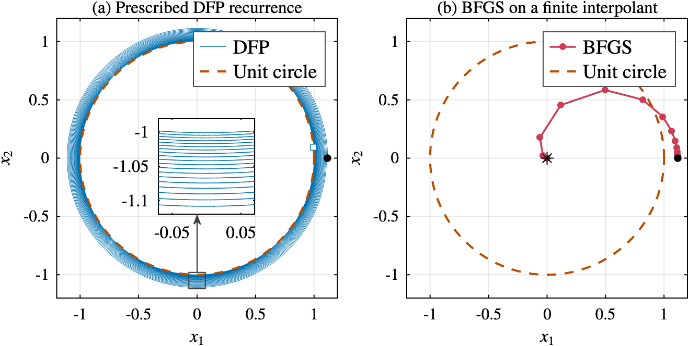
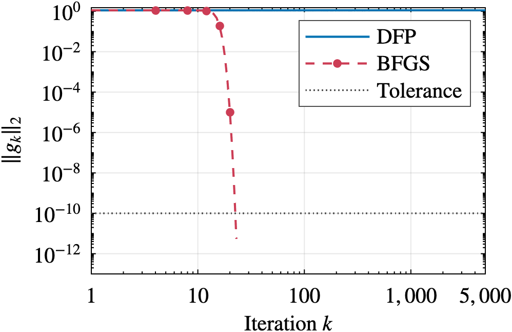

# DFP-Counterexample

MATLAB code and data for *A counterexample to global convergence of classical DFP under the standard strong Wolfe conditions*, by Benqi Liu, Zichen Wang, Zaiwen Wen, Yaxiang Yuan, and Liwei Zhang. The experiments below follow Section 5 of the revised manuscript. The first arXiv version describes an earlier construction. [Preprint](https://arxiv.org/abs/2608.21708)

## Figures 2 and 3

Both figures use the same finite objective function, starting point, and initial inverse Hessian approximation. The objective interpolates 200,001 prescribed points with starting index `j0 = 32^3`.

**Figure 2. Prescribed DFP and MATLAB BFGS trajectories.** The 200,000 prescribed steps make 19.0150 turns as the radius decreases from 1.1158688 to 1. BFGS starts at the same point, enters the disk and approaches the origin. The dashed curve in both panels is the unit circle.



**Figure 3. Gradient norms with MATLAB’s `fminunc`.** BFGS reaches a gradient norm of `5.39e-12` in 23 steps. DFP has gradient norm `1.10818` at the 5,000-step limit. This figure uses the same BFGS run as Figure 2(b).



The DFP steps in Figure 2 are prescribed by the construction. Figure 3 measures the finite-budget behavior of the solver. Theorem 1 gives the infinite nonconvergent sequence. The finite objective used here has a globally Lipschitz Hessian, so Theorem 2 applies to exact planar DFP with weak Wolfe steps on this objective.

## Reproduce the figures

The archive contains the prescribed points, the solver traces, the Hessian certificate, and the figures. To inspect the recorded runs directly, open the PDFs or the solver CSVs. [Download the Section 5 data](https://github.com/bqliu815/DFP-Counterexample/releases/download/section6-matched-data/DFP-Section6-data.zip)

To repeat the experiments, open the repository root in MATLAB and run:

```matlab
outDir = fullfile(pwd, 'results', 'section6');
run_experiments('paper', outDir);
```

`all` is an alias for `paper`. The reference run uses MATLAB R2025a, Optimization Toolbox, and Statistics and Machine Learning Toolbox. The exact Hessian certificate uses Python 3 with NumPy and h5py. For data-only figure export, single-threaded reproduction, or the optional historical experiments, see the [reproduction guide](docs/REPRODUCIBILITY.md).

## Formal verification and citation

The pinned Lean snapshot covers an earlier polar counterexample and the planar convergence theorem (Theorem 2 in the revision). The theorem map and walkthrough retain the numbering of the earlier manuscript. [Formalization and theorem map](docs/FORMAL_VERIFICATION.md) · [ReasLab project](https://reaslab.io/share/fqxVBj9GRaqFajkYxVtyXQR1210a9.MTc.YWxs)

[Citation metadata](CITATION.cff) · [MIT License](LICENSE) · [Contact Benqi Liu](mailto:bqliu@pku.edu.cn)
