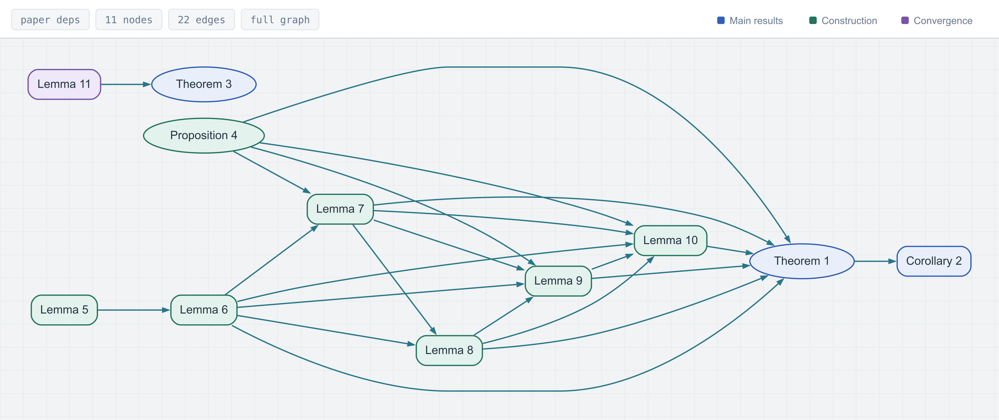

# DFP-Counterexample

This repository provides MATLAB code for the paper

*[A counterexample to global convergence of classical DFP under the standard
strong Wolfe conditions](https://arxiv.org/abs/2608.21708)*.

The code follows the revised manuscript; the linked arXiv preprint describes
the earlier construction.

Uniform convexity alone does not guarantee global convergence of classical
DFP under the standard strong Wolfe conditions. The paper gives a
two-dimensional $C^2$ counterexample whose gradient norms converge to a
positive constant and whose iterates accumulate on a circle. It also proves
convergence under the standard weak Wolfe conditions for strongly convex
$C^2$ objective functions in two dimensions when the Hessian is locally
Lipschitz continuous near the initial level set.

The MATLAB code implements the polar construction and reproduces the numerical
experiments in Sections 6.1–6.2 of the revised manuscript. The prescribed
two-step recurrence is evaluated directly. The DFP and BFGS
comparisons use MATLAB's `fminunc` on fixed finite objective functions
formed by local interpolation.

The recurrence uses the feedback
`phi = p*gamma_star/(gamma*nu(gamma)*(1/a+1/b))`, with `p=1/(1+beta)`.
The geometry and finite-function comparisons use the `2:1` angle coefficients
and `beta=1/2`. Separate recurrence diagnostics compare `beta=1/3,1/2,2/3`
and three strong Wolfe parameter pairs.

Lean formalization:
https://github.com/optpku/ReasBook/tree/f40e785158f79d8f0e645890825b840af912e327/ReasBook/Papers/DFP_wolfe_local/

Project on ReasLab:
https://reaslab.io/share/fqxVBj9GRaqFajkYxVtyXQR1210a9.MTc.YWxs

## Repository contents

| Path | Contents |
| --- | --- |
| `polar/PolarDFP.m` | Polar recurrence, finite interpolation, and DFP/BFGS solvers |
| `polar/run_polar_experiments.m` | Numerical experiments and exact certificates |
| `polar/certify_finite.m` | Support separation and global Hessian bounds |
| `polar/make_polar_figures.m` | Trajectory and solver figures, including the DFP detail inset |
| `polar/scaling_diagnostics.m` | Long-run recurrence diagnostics with sampled output |
| `polar/make_scaling_figure.m` | Radial decrease and gradient-correction diagnostics |
| `run_experiments.m` | Entry point for tests and paper experiments |
| `tests/` | Tests of the recurrence, interpolation, solver, and entry point |

## Installation

The reference experiments use MATLAB R2025a with Optimization Toolbox and
Statistics and Machine Learning Toolbox. Symbolic Math Toolbox is also
required for the exact certificates (`certify` and `all`).

Download the repository or clone it:

```sh
git clone https://github.com/bqliu815/DFP-Counterexample.git
```

Open the repository root folder in MATLAB. Run the tests and a short example with:

```matlab
run_experiments('test');
run_experiments('smoke');
```

To run the DFP/BFGS comparison directly:

```matlab
addpath('polar');
orbit = PolarDFP.orbit(4002, 400^3, 1.03);
objective = PolarDFP.finite(orbit);
dfp = PolarDFP.solve(objective, orbit, 'dfp', 5000);
bfgs = PolarDFP.solve(objective, orbit, 'bfgs', 5000);
dfp.summary
bfgs.summary
```

For a different fixed standard strong Wolfe pair, select a stable shape and
check a finite prescribed prefix with:

```matlab
pars = PolarDFP.wolfeParameters(0.2, 0.3, 0.5);
orbit = PolarDFP.orbit(10000, 400^3, pars);
orbit.summary
run_experiments('wolfe'); % checks (0.25,0.75), (0.2,0.3), and (0.8,0.9)
```

The starting index must be sufficiently large for the selected parameters.
The routine reports the actual endpoint ratios and fails if the matrix or
local inverse branch becomes invalid. Binary64 finite-prefix checks do not
prove the infinite construction.

Both methods use the same linear change of variables to retain the initial
search direction determined by the prescribed inverse Hessian approximation.
MATLAB's internal line search and update safeguards are retained.

## Reproducing the numerical experiments

To run only the three-exponent comparison in Section 6.1:

```matlab
run_experiments('scales');
```

This keeps the angle coefficients and Wolfe pair fixed, updates the feedback
for each exponent, and executes 10,000,000 cycles per case. The two panels
plot radial and gradient-correction ratios on a logarithmic cycle axis.
Every cycle is evaluated; only the saved output and residual checks are sampled.

The complete run generates all recurrence diagnostics and solver trajectories,
certifies the Hessian bounds, and exports the three numerical figures:

```matlab
run_experiments('all');
```

For the single-threaded setup used in the paper, run from the repository root:

```sh
matlab -singleCompThread -batch "run_experiments('all')"
```

Results are written to `results/paper/`. JSON summaries contain the quantities
reported in the tables. A second argument selects a different output directory.
See [docs/REPRODUCIBILITY.md](docs/REPRODUCIBILITY.md) for individual stages,
experimental parameters, and generated output files. Results are generated
locally and excluded from version control.

## Formal verification

The linked Lean 4 snapshot covers an earlier polar construction with Hessian
Hölder exponent `1/2`, the planar convergence theorem, and the center-manifold
analysis. It does not cover the general Hölder-exponent extension, the new
feedback, or the full strong Wolfe parameter range in the revised manuscript.
The table identifies the scope of each entry. The theorem map and video
walkthrough retain the earlier numbering.

| Earlier manuscript reference and scope | Lean formalization |
| --- | --- |
| Theorem 1: earlier polar counterexample | [Statement and proof](https://github.com/optpku/ReasBook/blob/f40e785158f79d8f0e645890825b840af912e327/ReasBook/Papers/DFP_wolfe_local/DFPWolfe/V21/Main.lean#L27) |
| Corollary 2: identity initialization for the earlier construction | [Statement and proof](https://github.com/optpku/ReasBook/blob/f40e785158f79d8f0e645890825b840af912e327/ReasBook/Papers/DFP_wolfe_local/DFPWolfe/V21/IdentityInitialization.lean#L53) |
| Theorem 3: planar convergence | [Statement and proof](https://github.com/optpku/ReasBook/blob/f40e785158f79d8f0e645890825b840af912e327/ReasBook/Papers/DFP_wolfe_local/DFPWolfe/V21/PlanarConvergence.lean#L100) |
| Lemma 4: continuation of the earlier recurrence | [Statement and proof](https://github.com/optpku/ReasBook/blob/f40e785158f79d8f0e645890825b840af912e327/ReasBook/Papers/DFP_wolfe_local/DFPWolfe/V21/PolarConstruction.lean#L35) |
| Lemma 5: geometry of the earlier recurrence | [Statement and proof](https://github.com/optpku/ReasBook/blob/f40e785158f79d8f0e645890825b840af912e327/ReasBook/Papers/DFP_wolfe_local/DFPWolfe/V21/PolarConstruction.lean#L102) |
| Lemma 6: interpolation for the earlier construction | [Statement and proof](https://github.com/optpku/ReasBook/blob/f40e785158f79d8f0e645890825b840af912e327/ReasBook/Papers/DFP_wolfe_local/DFPWolfe/V21/PolarConstruction.lean#L193) |
| Lemma 7: secant degeneration | [Statement and proof](https://github.com/optpku/ReasBook/blob/f40e785158f79d8f0e645890825b840af912e327/ReasBook/Papers/DFP_wolfe_local/DFPWolfe/V21/SecantDegeneration.lean#L49) |
| Earlier center-manifold analysis | [Statement and proof](https://github.com/optpku/ReasBook/blob/f40e785158f79d8f0e645890825b840af912e327/ReasBook/Papers/DFP_wolfe_local/DFPWolfe/V21/CenterManifold.lean#L2068) |

Click the theorem map to open the interactive paper view.

[](https://optpku.github.io/ReasBook/theorem-maps/papers/dfp_wolfe_local/?view=paper)

Interactive theorem map:
https://optpku.github.io/ReasBook/theorem-maps/papers/dfp_wolfe_local/?view=paper

A short walkthrough compares the earlier Theorem 1 with its Lean statement,
inspects the strong Wolfe conditions, and navigates definitions in ReasLab:

https://github.com/user-attachments/assets/05377f12-3f84-4915-98bf-e1aa71c52507

The formalization uses Lean 4.32.0 and mathlib 4.32.0. With Lean's `elan`
toolchain manager installed, run:

```sh
git clone --branch v4.32.0 https://github.com/optpku/ReasBook.git
cd ReasBook
git checkout f40e785158f79d8f0e645890825b840af912e327
cd ReasBook
lake exe cache get
lake lean Papers/DFP_wolfe_local/Paper.lean
```

`Paper.lean` imports the paper's public theorem interface. The last command
builds the required modules and checks this entry point.

The formalization is distributed under the Apache 2.0 License in ReasBook.

## Citation

If you use this code, please cite:

```bibtex
@misc{LiuEtAl2026DFP,
  author = {Benqi Liu and Zichen Wang and Zaiwen Wen and
            Yaxiang Yuan and Liwei Zhang},
  title  = {A counterexample to global convergence of classical {DFP}
            under the standard strong {Wolfe} conditions},
  year   = {2026},
  eprint = {2608.21708},
  archivePrefix = {arXiv},
  primaryClass = {math.OC},
  doi    = {10.48550/arXiv.2608.21708},
  url    = {https://arxiv.org/abs/2608.21708}
}
```

Machine-readable citation metadata is provided in [CITATION.cff](CITATION.cff).

## Authors and contact

- Benqi Liu: [bqliu@pku.edu.cn](mailto:bqliu@pku.edu.cn)
- Zichen Wang: [zichenwang25@stu.pku.edu.cn](mailto:zichenwang25@stu.pku.edu.cn)
- Zaiwen Wen: [wenzw@pku.edu.cn](mailto:wenzw@pku.edu.cn)
- Yaxiang Yuan: [yyx@lsec.cc.ac.cn](mailto:yyx@lsec.cc.ac.cn)
- Liwei Zhang: [zhanglw@mail.neu.edu.cn](mailto:zhanglw@mail.neu.edu.cn)

## License

Code is released under the [MIT License](LICENSE).
