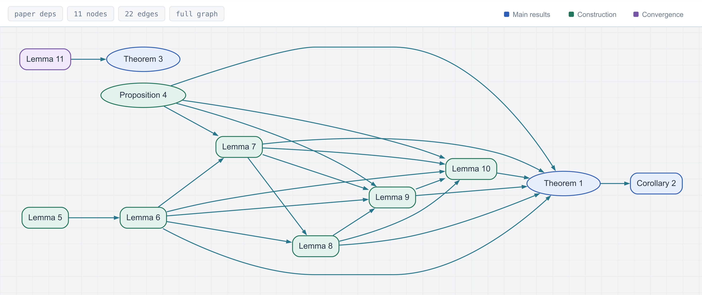

# Formal verification

The [pinned ReasBook snapshot](https://github.com/optpku/ReasBook/tree/f40e785158f79d8f0e645890825b840af912e327/ReasBook/Papers/DFP_wolfe_local/) includes the planar convergence theorem, an earlier polar counterexample with Hessian Hölder exponent $1/2$, and the earlier center-manifold analysis. The planar convergence theorem was Theorem 3 in the earlier manuscript and is Theorem 2 in the revision.

The revised Theorem 1 ranges over all Hölder exponents $0<\beta<1$ and all standard strong Wolfe parameter pairs. Its feedback and parameter extension lie outside the scope of this snapshot. The identity-initialization entry below applies to the earlier example. The table, dependency map, and walkthrough retain the earlier numbering.

| Earlier manuscript reference and scope | Lean formalization |
| --- | --- |
| Theorem 1: earlier polar counterexample | [Statement and proof](https://github.com/optpku/ReasBook/blob/f40e785158f79d8f0e645890825b840af912e327/ReasBook/Papers/DFP_wolfe_local/DFPWolfe/V21/Main.lean#L27) |
| Corollary 2: identity initialization for the earlier construction | [Statement and proof](https://github.com/optpku/ReasBook/blob/f40e785158f79d8f0e645890825b840af912e327/ReasBook/Papers/DFP_wolfe_local/DFPWolfe/V21/IdentityInitialization.lean#L53) |
| Theorem 3: planar convergence | [Statement and proof](https://github.com/optpku/ReasBook/blob/f40e785158f79d8f0e645890825b840af912e327/ReasBook/Papers/DFP_wolfe_local/DFPWolfe/V21/PlanarConvergence.lean#L100) |
| Lemma 4: continuation of the earlier recurrence | [Statement and proof](https://github.com/optpku/ReasBook/blob/f40e785158f79d8f0e645890825b840af912e327/ReasBook/Papers/DFP_wolfe_local/DFPWolfe/V21/PolarConstruction.lean#L35) |
| Lemma 5: geometry of the earlier recurrence | [Statement and proof](https://github.com/optpku/ReasBook/blob/f40e785158f79d8f0e645890825b840af912e327/ReasBook/Papers/DFP_wolfe_local/DFPWolfe/V21/PolarConstruction.lean#L102) |
| Lemma 6: interpolation for the earlier construction | [Statement and proof](https://github.com/optpku/ReasBook/blob/f40e785158f79d8f0e645890825b840af912e327/ReasBook/Papers/DFP_wolfe_local/DFPWolfe/V21/PolarConstruction.lean#L193) |
| Lemma 7: secant degeneration | [Statement and proof](https://github.com/optpku/ReasBook/blob/f40e785158f79d8f0e645890825b840af912e327/ReasBook/Papers/DFP_wolfe_local/DFPWolfe/V21/SecantDegeneration.lean#L49) |
| Earlier center-manifold analysis | [Statement and proof](https://github.com/optpku/ReasBook/blob/f40e785158f79d8f0e645890825b840af912e327/ReasBook/Papers/DFP_wolfe_local/DFPWolfe/V21/CenterManifold.lean#L2068) |

Click the theorem map to open the interactive paper view.

[](https://optpku.github.io/ReasBook/theorem-maps/papers/dfp_wolfe_local/?view=paper)

The walkthrough compares the earlier Theorem 1 with its Lean statement and follows the strong Wolfe definitions in ReasLab. [Video walkthrough](https://github.com/user-attachments/assets/05377f12-3f84-4915-98bf-e1aa71c52507) · [ReasLab project](https://reaslab.io/share/fqxVBj9GRaqFajkYxVtyXQR1210a9.MTc.YWxs)

The formalization uses Lean 4.32.0 and mathlib 4.32.0. With Lean's `elan`
toolchain manager installed, run:

```sh
git clone --branch v4.32.0 https://github.com/optpku/ReasBook.git
cd ReasBook
git checkout f40e785158f79d8f0e645890825b840af912e327
cd ReasBook
lake exe cache get
lake lean Papers/DFP_wolfe_local/Paper.lean
```

`Paper.lean` imports the paper's public theorem interface. The last command
builds the required modules and checks this entry point.

The formalization is distributed under the Apache 2.0 License in ReasBook.
